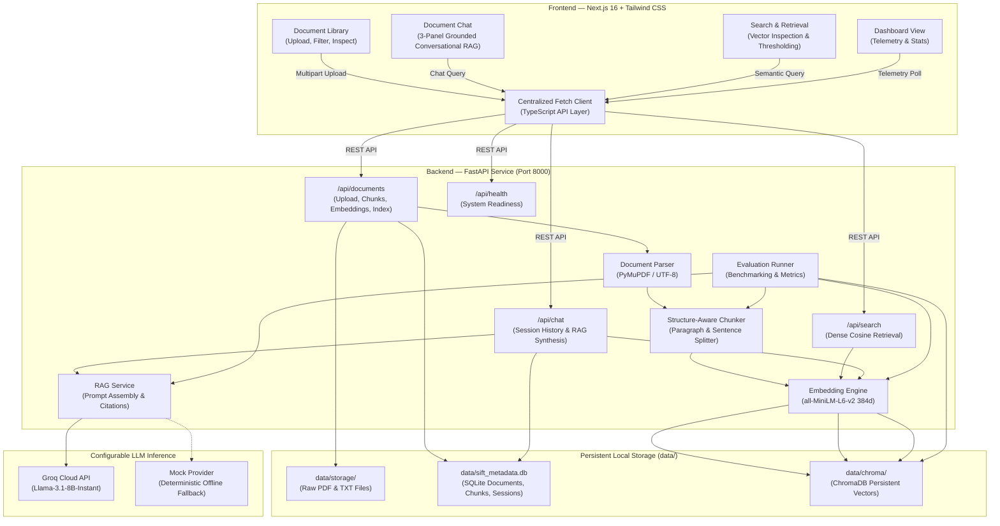

# SIFT — AI-Powered Document Intelligence Platform

> **Find what matters. Understand everything.**  
> Enterprise-grade Document Intelligence, Structure-Aware Chunking, Local Dense Vector Embeddings, Persistent ChromaDB Semantic Retrieval, and Verifiable Citation-Grounded RAG.

---

## 1. Project Overview

**SIFT** is a high-performance document intelligence and retrieval-augmented generation (RAG) platform. It allows users to ingest complex unstructured documents (PDF and TXT), automatically parse and segment them into structure-preserving chunks, generate 384-dimensional dense vector embeddings locally on CPU, and query the knowledge base through semantic search and conversational chat with page-level verifiable citations.

### Key Capabilities
- **Local Dense Embeddings**: Generates 384-dimensional dense vectors using `sentence-transformers/all-MiniLM-L6-v2` locally on CPU with zero cloud transmission of raw document tokens during vectorization.
- **Persistent Vector Engine**: Vector storage and cosine-distance indexing powered by persistent ChromaDB with HNSW indexing.
- **Structure-Aware Chunking**: PyMuPDF-based text and coordinate extraction with paragraph-aware splitting, configurable overlap, and exact page provenance.
- **Conversational RAG Chat**: Multi-turn conversational sessions with grounded answer synthesis (powered by Groq Llama-3.1-8B or configurable providers) and numbered citations linked directly to verified document coordinate excerpts.
- **Sub-15ms Semantic Retrieval**: Natural-language vector search with configurable cosine distance threshold, document-scoped filtering, and token provenance inspection.
- **RAG Evaluation Suite**: Deterministic quality benchmarking covering Precision@K, Recall@K, MRR, nDCG@K, Citation Correctness, Citation Coverage, Fact Recall, and Unsupported Refusal Accuracy.
- **Linear/Raycast Aesthetic**: Clean, dark charcoal visual identity (`#0E1015`, `#14171E`, `#1E232D`) with subtle emerald telemetry indicators and restrained blue accents.

---

## 2. Architecture & Data Flow



---

## 3. Technology Stack

| Layer | Technology | Purpose |
| :--- | :--- | :--- |
| **Frontend Framework** | **Next.js 16 (App Router)** | Client-side views, partial prefetching, static generation |
| **Frontend Language** | **TypeScript 5** | Strict end-to-end type safety |
| **Styling & Design** | **Tailwind CSS v4** | Dark charcoal theme, responsive breakpoints |
| **Icons & UI** | **Lucide React** | Lightweight vector icons |
| **Backend Framework**| **FastAPI (Python 3.11)** | High-throughput async REST endpoints |
| **PDF Extraction** | **PyMuPDF (fitz)** | Rapid text extraction and page coordinate provenance |
| **Embedding Model** | **all-MiniLM-L6-v2** | Local 384-dimensional dense vectors on CPU via `sentence-transformers` |
| **Vector Database** | **ChromaDB (Persistent)** | Persistent HNSW index with cosine distance metric |
| **Metadata Database**| **SQLite (WAL mode)** | Documents, structure-aware chunks, embeddings cache, sessions |
| **LLM Provider** | **Groq API / Llama-3.1-8B**| Rapid citation-grounded RAG answer synthesis |
| **Test Suites** | **Pytest + Jest / ESLint** | 88 backend regression tests, 0 ESLint errors |

---

## 4. Project Directory Structure

```
SIFT/
├── backend/                        # FastAPI Backend Application
│   ├── app/
│   │   ├── api/
│   │   │   └── routes/             # REST endpoints (documents, search, chat, health)
│   │   ├── core/                   # Settings, logging, custom exceptions
│   │   ├── evaluation/             # RAG Benchmark runner, dataset, and metrics
│   │   │   ├── dataset.py          # 10 benchmark queries across 4 categories
│   │   │   ├── retrieval_metrics.py# Precision@K, Recall@K, MRR, nDCG@K
│   │   │   ├── generation_metrics.py# Citation correctness, coverage, refusal accuracy
│   │   │   └── runner.py           # Automated evaluation runner & report exporter
│   │   ├── models/                 # Pydantic & domain models
│   │   ├── rag/
│   │   │   ├── chunking/           # Paragraph & sentence boundary chunker
│   │   │   ├── embeddings/         # SentenceTransformers engine & repository
│   │   │   ├── generation/         # RAG prompt assembler, Groq & Mock providers
│   │   │   ├── ingestion/          # PyMuPDF and plaintext parsers
│   │   │   └── retrieval/          # Persistent ChromaDB vector store
│   │   ├── repositories/           # SQLite repositories (documents, chunks, sessions)
│   │   ├── schemas/                # Inbound/outbound Pydantic schemas
│   │   └── utils/                  # Cryptographic hashing & file sanitization
│   ├── tests/                      # 88 automated unit and integration tests
│   ├── .env.example                # Safe backend environment template
│   ├── pyproject.toml              # Python package metadata & test settings
│   └── requirements.txt            # Python dependencies
├── src/                            # Next.js 16 Frontend
│   ├── app/                        # App router layout, page, and globals.css
│   ├── components/
│   │   ├── chat/                   # 3-Panel Document Chat & Citation Inspector
│   │   ├── common/                 # CommandPalette (Ctrl+K), global overlays
│   │   ├── dashboard/              # Workspace telemetry, metric cards, activity
│   │   ├── layout/                 # Collapsible Sidebar & TopHeader
│   │   ├── library/                # Document Library, Upload, Preview, Rename, Delete
│   │   └── search/                 # Semantic Search & Vector Retrieval Inspector
│   ├── context/                    # React Context (DocumentContext state management)
│   ├── lib/
│   │   └── api/                    # Centralized fetch client & route adapters
│   └── types/                      # Frontend TypeScript interfaces
├── data/                           # Self-contained local persistent storage (gitignored)
│   ├── chroma/                     # ChromaDB persistent vector collection
│   ├── models/                     # SentenceTransformers local weights cache
│   ├── reports/                    # RAG evaluation JSON and CSV benchmark reports
│   ├── storage/                    # Uploaded raw PDF and TXT documents
│   └── sift_metadata.db            # SQLite relational database
├── .env.example                    # Frontend environment template
├── .gitignore                      # Security-hardened gitignore
├── next.config.ts                  # Next.js configuration
├── package.json                    # Node.js dependencies
└── README.md                       # Comprehensive platform documentation
```

---

## 5. Prerequisites

Before running SIFT locally, ensure your system has:

- **Windows 10/11** with PowerShell 5.1+ or PowerShell 7+
- **Python 3.10+ or 3.11+** installed and added to `PATH`
- **Node.js 18.17+ or 20+** installed
- **Git** (optional, for version control)
- **Groq API Key** (optional free-tier key from [Groq Console](https://console.groq.com/keys) for live LLM generation; SIFT automatically falls back to deterministic offline simulation if unconfigured)

---

## 6. Setup & Installation (Windows PowerShell)

Open a PowerShell terminal in the repository root:

```powershell
# 1. Clone or navigate to the repository directory
cd c:\Users\kesha\OneDrive\Desktop\SIFT

# 2. Configure frontend environment
Copy-Item .env.example .env.local

# 3. Install frontend dependencies
npm install

# 4. Create Python virtual environment for backend
python -m venv backend\.venv

# 5. Activate virtual environment
backend\.venv\Scripts\Activate.ps1

# 6. Install backend dependencies
python -m pip install --upgrade pip
pip install -r backend\requirements.txt

# 7. Configure backend environment
Copy-Item backend\.env.example backend\.env
```

### Configuring the Groq LLM Key (Optional)
Open `backend/.env` in your text editor and provide your Groq key:
```ini
LLM_PROVIDER="groq"
GROQ_API_KEY="gsk_your_actual_key_here"
GROQ_MODEL="llama-3.1-8b-instant"
```
*Note: If no key is provided, SIFT operates in mock provider mode for deterministic local testing.*

---

## 7. Running the Application

### Start the FastAPI Backend (Port 8000)
In your first PowerShell terminal:
```powershell
# From the repository root with virtual environment activated:
backend\.venv\Scripts\python.exe -m uvicorn app.main:app --host 127.0.0.1 --port 8000 --app-dir backend
```
Verify the backend is healthy:
- Root info: [http://127.0.0.1:8000/](http://127.0.0.1:8000/)
- Swagger Docs: [http://127.0.0.1:8000/docs](http://127.0.0.1:8000/docs)
- Health Probe: [http://127.0.0.1:8000/api/health](http://127.0.0.1:8000/api/health)

### Start the Next.js Frontend (Port 3000)
In a second PowerShell terminal:
```powershell
npm run dev
```
Open your browser and navigate to:
**[http://localhost:3000](http://localhost:3000)**

---

## 8. API Documentation & Endpoints

| Method | Endpoint | Description |
| :--- | :--- | :--- |
| `GET` | `/` | Root service status and version information |
| `GET` | `/api/health` | Service health, indexed document count, and disk storage metrics |
| `POST`| `/api/documents/upload` | Ingests PDF or TXT files (multipart/form-data) with PyMuPDF parsing |
| `GET` | `/api/documents` | Lists all ingested documents with metadata and tags |
| `GET` | `/api/documents/{id}` | Retrieves detailed document metadata and extracted text |
| `PATCH`| `/api/documents/{id}/rename` | Renames a document in metadata |
| `DELETE`| `/api/documents/{id}` | Permanently purges document, disk file, chunks, and ChromaDB vectors |
| `POST`| `/api/documents/{id}/chunks` | Generates structure-preserving paragraph & sentence chunks |
| `GET` | `/api/documents/{id}/chunks` | Retrieves persisted chunks with page coordinates |
| `POST`| `/api/documents/{id}/embeddings` | Generates local 384d dense embeddings via MiniLM on CPU |
| `POST`| `/api/documents/{id}/index` | Inserts or refreshes dense vectors in persistent ChromaDB collection |
| `GET` | `/api/documents/{id}/index-status` | Inspects real-time ChromaDB collection indexing status |
| `POST`| `/api/search` | Natural-language semantic search with cosine distance & provenance |
| `POST`| `/api/chat` | Conversational RAG with citation generation & SQLite history persistence |
| `GET` | `/api/chat/sessions` | Lists previous conversational chat sessions |
| `GET` | `/api/chat/sessions/{id}` | Retrieves session message turns and citations |
| `DELETE`| `/api/chat/sessions/{id}` | Deletes a conversation session |

Interactive OpenAPI documentation is available live at `http://127.0.0.1:8000/docs`.

---

## 9. Testing & Quality Verification

SIFT includes a complete test suite across backend services, evaluation metrics, and frontend builds:

### Run Backend Regression Tests (88 tests)
```powershell
backend\.venv\Scripts\python.exe -m pytest backend\tests -v
```
*Expected Result: 88 passed, 1 skipped in ~5s.*

### Run Frontend Type Check & Production Build
```powershell
# TypeScript Type Check (0 errors)
npx tsc --noEmit

# ESLint Check (0 errors)
npm run lint

# Production Next.js Build
npm run build
```

---

## 10. RAG Evaluation Methodology & Benchmark Results

SIFT implements an automated, deterministic evaluation framework (`backend/app/evaluation/`) validating retrieval and answer generation quality across a 10-query benchmark dataset spanning 4 critical challenge categories:

1. **Single Chunk** (`eval-q01`, `eval-q02`, `eval-q03`): Direct factual lookups with exact target passage retrieval.
2. **Multi Chunk** (`eval-q04`, `eval-q05`, `eval-q06`): Cross-document comparative synthesis requiring multi-passage coordination.
3. **Hard Negative** (`eval-q07`, `eval-q08`): Distractor queries with semantic surface overlap but distinct domain facts.
4. **Unsupported** (`eval-q09`, `eval-q10`): Out-of-domain inquiries requiring refusal without hallucination.

### Latest Benchmark Scores (Artifact: `data/reports/`)
- **Recall@5**: **1.0000** (All ground-truth target chunks successfully retrieved in top 5)
- **MRR (Mean Reciprocal Rank)**: **0.9286**
- **nDCG@5**: **0.9473** (High ranking quality and top-result relevance)
- **Precision@5**: **0.2571**
- **Citation Correctness**: **1.0000** (100% of generated citations match genuine retrieved passage IDs)
- **Citation Coverage**: **1.0000**
- **Fact Recall**: **1.0000**
- **Unsupported Refusal Accuracy**: **1.0000** (Accurate refusal on out-of-corpus queries)
- **Mean End-to-End Latency**: **99.5 ms**

---

## 11. Security, Data Persistence & Privacy

### Security Controls
- **Zero API Key Leakage**: No credentials or private keys are exposed to the client browser. The frontend interacts strictly with public `/api/*` endpoints.
- **Strict Git Boundaries**: `.env`, `.env.local`, virtual environments, SQLite databases, ChromaDB stores, and uploaded documents are strictly gitignored.
- **Upload Hardening**:
  - Extension whitelist: `.pdf`, `.txt`
  - Magic header validation: Verifies `%PDF-` byte signatures before processing.
  - Path traversal protection: Normalizes filenames and enforces storage boundary confinement (`startsWith(storage_dir)`).
  - Maximum upload size: Enforces configurable 10 MB limit (`MAX_UPLOAD_SIZE_MB`).
  - Corrupted and zero-byte file rejection.
- **HTTP Security Headers**: Injected into every response (`X-Content-Type-Options: nosniff`, `X-Frame-Options: DENY`, `X-XSS-Protection: 1; mode=block`, `Referrer-Policy: strict-origin-when-cross-origin`).
- **Clean Error Handling**: Internal exceptions return sanitised error structures without leaking stack traces or host paths.

### Data Persistence & Backup Procedures
All application data is self-contained under the `data/` directory:
- `data/sift_metadata.db`: SQLite database storing document metadata, structure chunks, embeddings, and chat sessions.
- `data/chroma/`: Persistent ChromaDB vector database storing 384-dimensional dense vectors with HNSW indexing.
- `data/storage/`: Stored raw PDF and TXT files.

**To Backup**:
```powershell
Copy-Item -Path data -Destination data_backup_$(Get-Date -Format 'yyyyMMdd') -Recurse
```

**To Restore**:
Restore the copied `data/` folder to the repository root.

---

## 12. Deployment Readiness & Production Architecture

### Single-Tenant Local-First Design
SIFT is designed as an enterprise-grade, local-first document intelligence platform. It does not implement multi-tenant user authentication or row-level permission isolation. All scoped documents in the active workspace are accessible to the local user.

### Production Deployment Guidelines
- **Persistent Storage is Mandatory**: Because ChromaDB and SQLite write to the local filesystem, **do not deploy SIFT to ephemeral serverless platforms** (e.g., standard Vercel serverless functions or ephemeral Heroku containers) where disk storage is wiped on restart.
- **Recommended Cloud Targets**:
  - **Docker Compose on a VPS / Cloud VM** (AWS EC2, DigitalOcean Droplet, Hetzner, Linode) with mounted persistent volume.
  - **Container Platforms with Persistent Volume Claims** (Fly.io with mounted volumes, Railway with Volume, AWS ECS with EFS).
- **Frontend Configuration**: The frontend API URL is fully configurable at build/runtime via `NEXT_PUBLIC_API_BASE_URL` without changing source code.

---

## 13. Known Limitations

- **Scanned Image PDFs (OCR)**: SIFT uses PyMuPDF for native vector and text extraction. PDFs containing scanned images without an embedded text layer (OCR) will be detected as `NoExtractableTextError`. Optical character recognition (e.g. Tesseract) can be chained upstream.
- **Single-User Workspace**: SIFT currently manages one default workspace without multi-user authentication.
- **File Formats**: Currently supports native PDF and UTF-8 plain text (TXT). Microsoft Word (DOCX) and Markdown (MD) parsers can be plugged into the modular `DocumentParser` pipeline.

---

## 14. User Interface Gallery

| Interface | Description |
| :--- | :--- |
| **Dashboard** | Real-time telemetry, storage utilization, active document counts, and recent query shortcuts. |
| **Document Library** | Multi-file upload, batch re-indexing, search filtering by domain tag, and cryptographic hash verification. |
| **Document Chat** | Three-panel workflow: Scope Navigator (left), Grounded Conversation (center), and PDF Inspector Canvas with verified excerpt highlight (right). |
| **Search & Retrieval** | Sub-15ms semantic search with cosine distance telemetry, similarity threshold slider, and token provenance inspector. |

---

## 15. License

MIT License. Designed and built for portfolio evaluation and technical demonstration.
